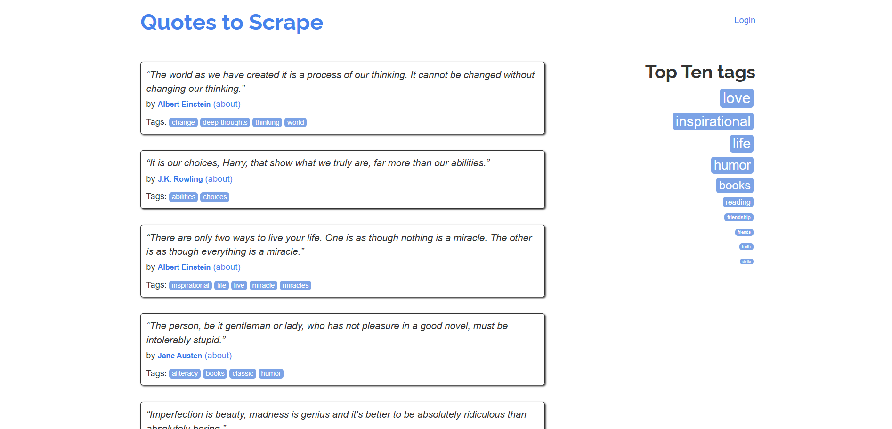

# 使用 Python 中的 HTTPX 进行网页爬虫

[](https://www.bright.cn/) 

本指南介绍如何使用功能强大的 Python HTTP 客户端 HTTPX 进行网页爬虫：

- [什么是 HTTPX？](#什么是-httpx)
- [使用 HTTPX 抓取：分步指南](#使用-httpx-抓取分步指南)
  - [第 1 步：项目设置](#第-1-步项目设置)
  - [第 2 步：安装抓取库](#第-2-步安装抓取库)
  - [第 3 步：获取目标页面的 HTML](#第-3-步获取目标页面的-html)
  - [第 4 步：解析 HTML](#第-4-步解析-html)
  - [第 5 步：从中抓取数据](#第-5-步从中抓取数据)
  - [第 6 步：导出抓取的数据](#第-6-步导出抓取的数据)
  - [第 7 步：整合所有步骤](#第-7-步整合所有步骤)
- [HTTPX 网页爬虫的高级功能和技术](#httpx-网页爬虫的高级功能和技术)
  - [设置自定义标头](#设置自定义标头)
  - [设置自定义 User-Agent](#设置自定义-user-agent)
  - [设置 Cookie](#设置-cookie)
  - [集成代理](#集成代理)
  - [错误处理](#错误处理)
  - [会话处理](#会话处理)
  - [异步 API](#异步-api)
  - [重试失败的请求](#重试失败的请求)
- [HTTPX 与 Requests 网页爬虫对比](#httpx-与-requests-网页爬虫对比)
- [总结](#总结)


## 什么是 HTTPX？

[HTTPX](https://github.com/encode/httpx) 是一个功能齐全的 Python 3 HTTP 客户端，构建于 [`httpcore`](https://pypi.org/project/httpcore/) 库之上。即使在高强度多线程环境下，它也能提供可靠的性能。HTTPX 同时提供同步和异步 API，并支持 HTTP/1.1 和 HTTP/2 协议。

**功能**

- **兼容 Requests 的 API**：接口与 `requests` 基本一致，上手和迁移都很容易。
- **同步与异步接口**：默认提供标准同步接口，需要时也可使用异步客户端。
- **支持 HTTP/1.1 和 HTTP/2**：同时支持两种协议版本。
- **直接请求 WSGI/ASGI 应用**：无需启动服务器即可向 Web 应用发送请求。
- **全面的超时控制**：所有操作都有严格的超时设置。
- **完整的类型注解**：代码完全类型化，测试覆盖率达到 100%。
- **`requests` 的标准功能**：连接池与 Keep-Alive、Cookie 会话、HTTP(S) 代理、基本/摘要身份验证等。

**优点**

- **可通过命令行使用**：可通过 [`httpx[cli]`](https://pypi.org/project/httpx/) 访问。
- **功能丰富**：支持 HTTP/2 和异步 API。
- **持续活跃开发**：通过定期更新不断改进。

**缺点**

- **更新频繁**：新版本可能会引入破坏性变更。
- **普及度较低**：使用范围不如 [`requests`](https://requests.readthedocs.io/en/latest/) 库广泛。

## 使用 HTTPX 抓取：分步指南

HTTPX 是一个 HTTP 客户端，因此要解析它获取的 HTML 并从中提取数据，你需要使用 [BeautifulSoup](https://www.crummy.com/software/BeautifulSoup/bs4/doc/) 之类的 HTML 解析器。

> **警告**：\
> 虽然 HTTPX 只用于流程的早期阶段，但我们将带你完成整个工作流。如果你对更高级的 HTTPX 抓取技术感兴趣，可以在完成第 3 步后直接跳到下一章。

### 第 1 步：项目设置

在你的计算机上安装 Python 3+，并为 HTTPX 抓取项目创建一个目录：

```bash
mkdir httpx-scraper
```

进入该目录并初始化一个[虚拟环境](https://docs.python.org/3/library/venv.html)：

```bash
cd httpx-scraper
python -m venv env
```

在你的 Python IDE 中打开项目文件夹，在其中创建一个 `scraper.py` 文件，然后激活虚拟环境。在 Linux 或 macOS 上，运行：

```bash
./env/bin/activate
```

在 Windows 上：

```
env/Scripts/activate
```

### 第 2 步：安装抓取库

安装 HTTPX 和 BeautifulSoup：

```bash
pip install httpx beautifulsoup4
```

将已添加的依赖项导入你的 `scraper.py` 脚本：

```python
import httpx
from bs4 import BeautifulSoup
```

### 第 3 步：获取目标页面的 HTML

在此示例中，目标页面是“[Quotes to Scrape](https://quotes.toscrape.com/)”网站：



使用 HTTPX 的 `get()` 方法获取首页的 HTML：

```python
# Make an HTTP GET request to the target page
response = httpx.get("http://quotes.toscrape.com")
```

HTTPX 会在后台向服务器发出 HTTP GET 请求，服务器将返回页面的 HTML。你可以使用 `response.text` 属性访问 HTML 内容：

```python
html = response.text
print(html)
```

这将输出原始 HTML 内容：

```html
<!DOCTYPE html>
<html lang="en">
<head>
    <meta charset="UTF-8">
    <title>Quotes to Scrape</title>
    <link rel="stylesheet" href="/static/bootstrap.min.css">
    <link rel="stylesheet" href="/static/main.css">
</head>
<body>
    <!-- omitted for brevity... -->
</body>
</html>
```

### 第 4 步：解析 HTML

将 HTML 内容传递给 BeautifulSoup 构造函数进行解析：

```python
# Parse the HTML content using
 soup = BeautifulSoup(html, "html.parser")
```

现在，`soup` 变量包含已解析的 HTML，并提供了用于提取数据的方法。

### 第 5 步：从中抓取数据

从页面抓取引语数据：

```python
# Where to store the scraped data
quotes = []

# Extract all quotes from the page
quote_elements = soup.find_all("div", class_="quote")

# Loop through quotes and extract text, author, and tags
for quote_element in quote_elements:
    text = quote_element.find("span", class_="text").get_text().replace("“", "").replace("”", "")
    author = quote_element.find("small", class_="author")
    tags = [tag.get_text() for tag in quote_element.find_all("a", class_="tag")]

    # Store the scraped data
    quotes.append({
        "text": text,
        "author": author,
        "tags": tags
    })
```

此代码片段定义了一个名为 `quotes` 的列表，用于存储抓取的数据。然后，它会选择所有引语 HTML 元素并遍历这些元素，以提取引语文本、作者和标签。每条提取的引语都以字典形式存储在 `quotes` 列表中，从而整理数据以便进一步使用或导出。

### 第 6 步：导出抓取的数据

将抓取的数据导出到 CSV 文件：

```python
# Specify the file name for export
with open("quotes.csv", mode="w", newline="", encoding="utf-8") as file:
    writer = csv.DictWriter(file, fieldnames=["text", "author", "tags"])

    # Write the header row
    writer.writeheader()

    # Write the scraped quotes data
    writer.writerows(quotes)
```

此代码片段以写入模式打开名为 `quotes.csv` 的文件，定义列标题（`text`、`author`、`tags`），将标题写入文件，然后将 `quotes` 列表中的每个字典写入 CSV 文件。`csv.DictWriter` 负责处理格式，让结构化数据的存储变得简单。

从 Python 标准库导入 `csv`：

```python
import csv
```

### 第 7 步：整合所有步骤

最终的 HTTPX 网页爬虫脚本将包含以下代码：

```python
import httpx
from bs4 import BeautifulSoup
import csv

# Make an HTTP GET request to the target page
response = httpx.get("http://quotes.toscrape.com")

# Access the HTML of the target page
html = response.text

# Parse the HTML content using BeautifulSoup
soup = BeautifulSoup(html, "html.parser")

# Where to store the scraped data
quotes = []

# Extract all quotes from the page
quote_elements = soup.find_all("div", class_="quote")

# Loop through quotes and extract text, author, and tags
for quote_element in quote_elements:
    text = quote_element.find("span", class_="text").get_text().replace("“", "").replace("”", "")
    author = quote_element.find("small", class_="author").get_text()
    tags = [tag.get_text() for tag in quote_element.find_all("a", class_="tag")]

    # Store the scraped data
    quotes.append({
        "text": text,
        "author": author,
        "tags": tags
    })

# Specify the file name for export
with open("quotes.csv", mode="w", newline="", encoding="utf-8") as file:
    writer = csv.DictWriter(file, fieldnames=["text", "author", "tags"])

    # Write the header row
    writer.writeheader()

    # Write the scraped quotes data
    writer.writerows(quotes)
```

使用以下命令执行：

```bash
python scraper.py
```

或者，在 Linux/macOS 上：

```bash
python3 scraper.py
```

项目根文件夹中将出现一个 `quotes.csv` 文件，其中包含以下内容：


## HTTPX 网页爬虫的高级功能和技术

让我们使用一个更复杂的示例。目标网站是 [HTTPBin.io 的 `/anything` 端点](https://httpbin.io/anything)。这是一个特殊的 API，会返回调用方发送的 IP 地址、标头及其他信息。

### 设置自定义标头

HTTPX 允许你使用 `headers` 参数[指定自定义标头](https://www.python-httpx.org/quickstart/#custom-headers)：

```python
import httpx

# Custom headers for the request
headers = {
    "accept": "application/json",
    "accept-language": "en-US,en;q=0.9,fr-FR;q=0.8,fr;q=0.7,es-US;q=0.6,es;q=0.5,it-IT;q=0.4,it;q=0.3"
}

# Make a GET request with custom headers
response = httpx.get("https://httpbin.io/anything", headers=headers)
# Handle the response...
```

### 设置自定义 User-Agent

[`User-Agent`](https://developer.mozilla.org/en-US/docs/Web/HTTP/Headers/User-Agent) 是[网页爬虫最重要的 HTTP 标头](https://www.bright.cn/blog/web-data/http-headers-for-web-scraping)之一。默认情况下，HTTPX 使用以下 `User-Agent`：

```
python-httpx/<VERSION>
```

这个值很容易暴露你的请求是自动发送的，可能导致目标网站将其屏蔽。

为避免这种情况，你可以设置自定义 `User-Agent` 来模拟真实浏览器，如下所示：

```python
import httpx

# Define a custom User-Agent
headers = {
    "Mozilla/5.0 (Windows NT 10.0; Win64; x64) AppleWebKit/537.36 (KHTML, like Gecko) Chrome/132.0.0.0 Safari/537.36"
}

# Make a GET request with the custom User-Agent
response = httpx.get("https://httpbin.io/anything", headers=headers)
# Handle the response...
```

### 设置 Cookie

使用 [`cookies` 参数](https://www.python-httpx.org/quickstart/#cookies)在 HTTPX 中设置 Cookie：

```python
import httpx

# Define cookies as a dictionary
cookies = {
    "session_id": "3126hdsab161hdabg47adgb",
    "user_preferences": "dark_mode=true"
}

# Make a GET request with custom cookies
response = httpx.get("https://httpbin.io/anything", cookies=cookies)
# Handle the response...
```

这让你能够加入网页爬虫请求所需的会话数据。

### 集成代理

现在，[通过代理路由 HTTPX 请求](https://www.python-httpx.org/advanced/proxies/)，以便在进行网页爬虫时保护你的身份并避免 IP 被封禁。为此，请使用 `proxies` 参数：

```python
import httpx

# Replace with the URL of your proxy server
proxy = "<YOUR_PROXY_URL>"

# Make a GET request through a proxy server
response = httpx.get("https://httpbin.io/anything", proxy=proxy)
# Handle the response...
```

### 错误处理

默认情况下，HTTPX 仅针对[连接或网络问题](https://www.python-httpx.org/exceptions/)引发错误。若还要针对具有 [`4xx`](https://developer.mozilla.org/en-US/docs/Web/HTTP/Status#client_error_responses) 和 [`5xx`](https://developer.mozilla.org/en-US/docs/Web/HTTP/Status#server_error_responses) 状态码的 HTTP 响应引发异常，请按如下方式使用 `raise_for_status()` 方法：

```python
import httpx

try:
    response = httpx.get("https://httpbin.io/anything")
    # Raise an exception for 4xx and 5xx responses
    response.raise_for_status()
    # Handle the response...
except httpx.HTTPStatusError as e:
    # Handle HTTP status errors
    print(f"HTTP error occurred: {e}")
except httpx.RequestError as e:
    # Handle connection or network errors
    print(f"Request error occurred: {e}")
```

### 会话处理


使用 HTTPX 的顶层 API 时，每次请求都会创建一个新连接，这意味着 TCP 连接不会被复用。随着向同一主机发出的请求数量增加，这种方法会变得低效。

而使用 `httpx.Client` 实例可以启用 [HTTP 连接池](https://devblogs.microsoft.com/premier-developer/the-art-of-http-connection-pooling-how-to-optimize-your-connections-for-peak-performance/)。这意味着，对同一主机的多个请求可以复用现有 TCP 连接，而不必为每个请求创建新连接。

与顶层 API 相比，使用 `Client` 具有以下一些优势：

- 减少请求延迟，因为不需要重复握手
- 降低 CPU 使用率并减少往返次数
- 减少网络流量

此外，`Client` 实例还支持顶层 API 不具备的会话处理功能，包括：

- 在请求之间持久保留 Cookie
- 将配置应用于所有传出请求
- 通过 HTTP 代理发送请求

通常建议在 HTTPX 中通过上下文管理器（`with` 语句）使用 `Client`：

```python
import httpx

with httpx.Client() as client:
    # Make an HTTP request using the client
    response = client.get("https://httpbin.io/anything")

    # Extract the JSON response data and print it
    response_data = response.json()
    print(response_data)
```

或者，你也可以手动管理客户端，并使用 `client.close()` 显式关闭连接池：

```python
import httpx

client = httpx.Client()
try:
    # Make an HTTP request using the client
    response = client.get("https://httpbin.io/anything")

    # Extract the JSON response data and print it
    response_data = response.json()
    print(response_data)
except:
  # Handle the error...
  pass
finally:
  # Close the client connections and release resources
  client.close()
```

> **注意**：\
> 如果你熟悉 `requests` 库，那么 `httpx.Client()` 的作用与 [`requests.Session()`](https://requests.readthedocs.io/en/latest/user/advanced/#session-objects) 类似。

### 异步 API

默认情况下，HTTPX 提供标准同步 API。同时，它也提供可在需要时使用的[异步客户端](https://www.python-httpx.org/async/)。如果你正在使用 [`asyncio`](https://docs.python.org/3/library/asyncio.html)，使用异步客户端对于高效发送传出 HTTP 请求至关重要。

要在 HTTPX 中发出异步请求，请初始化 `AsyncClient`，并使用它发出 GET 请求，如下所示：

```python
import httpx
import asyncio

async def fetch(url):
    async with httpx.AsyncClient() as client:
        response = await client.get(url)
        return response.text

async def main():
    urls = ["https://httpbin.io/anything"] * 5
    responses = await asyncio.gather(*(fetch(url) for url in urls))
    for response in responses:
        print(response)

asyncio.run(main())
```

[`with`](https://docs.python.org/3/reference/compound_stmts.html#with) 语句可确保客户端在代码块结束时自动关闭。或者，如果你手动管理客户端，也可以使用 `await client.close()` 显式关闭它。

使用 `AsyncClient` 时，所有 HTTPX 请求方法（`get()`、`post()` 等）都是异步的。因此，你必须在调用它们之前添加 `await` 才能获得响应。

### 重试失败的请求

网页爬虫运行期间的网络不稳定可能会导致连接失败或超时。HTTPX 通过其 [`HTTPTransport`](https://www.python-httpx.org/advanced/transports/) 接口简化了此类问题的处理。当发生 `httpx.ConnectError` 或 `httpx.ConnectTimeout` 时，此机制会重试请求。

以下代码展示了如何配置传输层，使请求最多重试 3 次：

```python
import httpx

# Configure transport with retry capability on connection errors or timeouts
transport = httpx.HTTPTransport(retries=3)

# Use the transport with an HTTPX client
with httpx.Client(transport=transport) as client:
    # Make a GET request
    response = client.get("https://httpbin.io/anything")
    # Handle the response...
```

只有与连接相关的错误才会触发重试。要处理读写错误或特定 HTTP 状态码，你需要使用 [`tenacity`](https://tenacity.readthedocs.io/en/latest/) 等库实现自定义重试逻辑。

## HTTPX 与 Requests 网页爬虫对比

下表比较了 HTTPX 和[用于网页爬虫的 Requests](https://www.bright.cn/blog/web-data/python-requests-guide)：

| **功能** | **HTTPX** | **Requests** |
| --- | --- | --- |
| **GitHub 星标数** | 8k  | 52.4k |
| **异步支持** | ✔️  | ❌   |
| **连接池** | ✔️  | ✔️  |
| **HTTP/2 支持** | ✔️  | ❌   |
| **User-Agent 自定义** | ✔️  | ✔️  |
| **代理支持** | ✔️  | ✔️  |
| **Cookie 处理** | ✔️  | ✔️  |
| **超时** | 可针对连接和读取进行自定义 | 可针对连接和读取进行自定义 |
| **重试机制** | 可通过传输层使用 | 可通过 `HTTPAdapter`s 使用 |
| **性能** | 高 | 中 |
| **社区支持和普及度** | 持续增长 | 庞大 |

## 总结

自动 HTTP 请求会暴露你的公网 IP 地址，可能泄露你的身份和位置，从而损害你的隐私。要增强安全性和隐私保护，请使用代理服务器隐藏你的 IP 地址。

Bright Data 掌控着全球顶尖的代理服务器，为《财富》500 强企业和超过 20,000 名客户提供服务。其产品包括多种代理类型：

- [数据中心代理](https://www.bright.cn/proxy-types/datacenter-proxies)：超过 770,000 个数据中心 IP。
- [住宅代理](https://www.bright.cn/proxy-types/residential-proxies)：覆盖 195 多个国家/地区的超过 7200 万个住宅 IP。
- [ISP 代理](https://www.bright.cn/proxy-types/isp-proxies)：超过 700,000 个 ISP IP。

立即创建免费的 Bright Data 账户，测试我们的抓取解决方案和代理！
